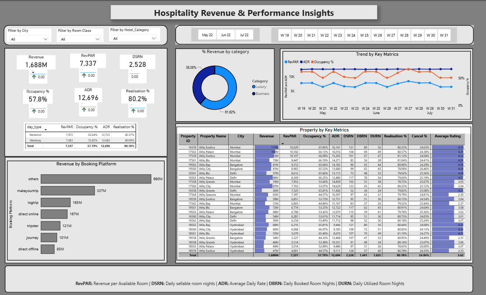

# Hospitality Revenue & Performance Insights

**RevPAR, Occupancy, and ADR Across Four Cities in Power BI** | Power BI, DAX, Dashboard Design

I turned booking data for 25 hotels in four cities into a Power BI dashboard that tracks revenue, RevPAR, ADR, occupancy, realisation, and cancellation, and shows which cities, properties, and booking platforms drive the results.

**Objective:** To monitor hotel revenue performance by tracking RevPAR, occupancy, and ADR across cities, properties, booking platforms, and room classes, and to find which hotels need attention first.

## Dashboard Preview



Full case study (16 slides): [Hospitality_Revenue_Case_Study.pdf](reports/Hospitality_Revenue_Case_Study.pdf)

## Business Questions

1. How is revenue performing: RevPAR, occupancy, ADR, and realisation?
2. Which cities, properties, and booking platforms drive the revenue?
3. How do weekends, hotel categories, and room classes differ?
4. Which properties underperform, and what should be done first?

## Dataset

[How Data Analysts Build Dashboard in Real Time? | Revenue Insights | Hospitality Domain](https://codebasics.io/resources/end-to-end-data-analyst-project) by Codebasics: sample hotel booking and revenue data for 25 Atliq properties in Mumbai, Bangalore, Delhi, and Hyderabad, for weeks W19 to W31 (May to July 2022). The raw data is not included in this repository, because Codebasics allows the files for learning use only; download them from the link above. Fields used include city, property, hotel category (Luxury, Business), room class (Standard, Elite, Premium, Presidential), booking platform, day type (weekday, weekend), revenue, room nights (DSRN, DBRN, DURN), realisation %, cancellation %, and average rating. The report does not state a currency and has no cost data, so the analysis describes revenue, not profit.

## Approach

1. **Define KPIs:** revenue, RevPAR, ADR, occupancy, realisation, and cancellation, with a week-over-week change measure in DAX for each KPI card.
2. **Build:** one report page with KPI cards, a weekday and weekend table, revenue by category and booking platform, a weekly trend, and a property table.
3. **Filter:** slicers for City, Room Class, Hotel Category, Month, and Week.
4. **Format:** consistent number formats so cards, tables, and charts show the same numbers, with clear labels and solid trend lines.
5. **Read:** the results, then write findings, limits, and recommendations.

## Key Findings

* Revenue is 1,688M, RevPAR 7,337, ADR 12,696, and occupancy 57.8% (1,461 booked of 2,528 sellable room nights).
* Mumbai earns 661M (39.2%), with RevPAR 8,897 and ADR 15,385. Bangalore earns 415M, Hyderabad 321M, and Delhi 291M.
* Delhi has the highest occupancy (60.4%) but an ADR of 12,159, against 15,385 in Mumbai. Hyderabad has the lowest RevPAR (5,405) and ADR (9,322).
* Weekend RevPAR is 12.6% above weekday (7,972 against 7,083). It comes from occupancy (62.6% against 55.9%); ADR is almost the same (12,725 against 12,682).
* Room class changes price, not occupancy: in Mumbai, Presidential RevPAR is 16,962 against 5,693 for Standard (3.0x), while occupancy is 58.7% and 58.6%.
* The top three properties by RevPAR are all in Mumbai (10,107 to 10,629). The bottom three are all in Hyderabad: Exotica (4,061), Palace (5,014), and Grands (5,514).
* Occupancy follows ratings in three tiers: about 65% to 66% for hotels rated 4.2 and above, about 53% near 3.0, and 44% to 45% near 2.3.
* Others bring 690M (40.9%) of revenue, Makeyourtrip 337M (20.0%), and direct bookings 252M (14.9%).

## Recommendations

* Fix the three weakest Hyderabad hotels first: Exotica, Palace, and Grands have RevPAR of 4,061 to 5,514, against 7,337 overall.
* Test higher weekend prices, because weekend occupancy is 6.8 points higher, but ADR is only 0.3% higher.
* Review service at the low-rated hotels, since ratings near 2.3 go with about 44% occupancy.
* Grow direct bookings and break down the Others platform, which is 40.9% of revenue and not explained.
* Fix the weekly axis (W23 and W27 appear twice) with a week-start date, then add a forecast once more weeks are loaded.

## Limits

* Three months of data (W19 to W31), so there is no seasonality or year-on-year view.
* Revenue, not profit: there is no cost data, and the report does not state a currency.
* Realisation (80.2%) and cancellation (24.8%) add up to more than 100%, so they use different bases.
* W23 and W27 appear twice on the weekly axis, once per month, so those points cover part of a week.

## Tools and Skills

**Tools:** Power BI, DAX (week-over-week measures), Dashboard Design

**Skills:** Data Analysis, Data Visualization, Dashboard Design, KPI Design, Revenue Analysis, Data Storytelling

## Repository Structure

```
Hospitality-Revenue-Performance-Insights/
├── README.md
├── dashboard/   (dashboard image)
└── reports/     (case study PDF)
```

## Author

Umair Khalil | Senior Data Analyst

## Disclaimer

Independent portfolio project, not affiliated with Codebasics. Data: [How Data Analysts Build Dashboard in Real Time? | Revenue Insights | Hospitality Domain](https://codebasics.io/resources/end-to-end-data-analyst-project) by Codebasics. Dataset credit to Codebasics. All figures come from the Power BI dashboard (4 cities, 25 properties, W19 to W31, May to July 2022). The report does not state a currency.
